# ERD · Current schema

[← Plan index](../README.md) · As of migration `0010` (P1-8 Step 1 + P1-28) (`packages/database/src/schema`) · Next: [MVP-1 additions](mvp-1.md)

```mermaid
erDiagram
    users ||--o{ couple_memberships : "has"
    couples ||--o{ couple_memberships : "has"
    couples ||--o{ couple_invitations : "issues"
    users ||--o{ couple_invitations : "invited_by"
    users ||--o{ refresh_tokens : "owns"
    users ||--o{ email_verification_tokens : "owns"
    prompt_themes ||--o{ prompts : "groups"
    prompts ||--o{ prompts : "parent_prompt_id (follow-ups)"
    prompts ||--o{ prompt_tag_links : "tagged"
    prompt_tags ||--o{ prompt_tag_links : "tags"
    conversation_sessions ||--o{ conversation_sessions : "parent_session_id (follow-ups)"
    couples ||--o{ conversation_sessions : "has"
    prompts ||--o{ conversation_sessions : "used by"
    conversation_sessions ||--o{ session_responses : "has (one per member)"
    users ||--o{ session_responses : "writes"
    conversation_sessions ||--o{ session_reveals : "has (one per member)"
    users ||--o{ session_reveals : "reveals"
    users |o--o{ audit_events : "actor (no FK)"
    users ||--o{ push_subscriptions : "enables"

    users {
        uuid id PK "also JWT sub"
        text email UK
        text password_hash "argon2id"
        boolean email_verified
        text display_name "1–40 chars (CHECK)"
        date date_of_birth
        timestamptz created_at
        timestamptz updated_at
    }
    couples {
        uuid id PK
        text status "forming|active|dissolving|dissolved"
        timestamptz created_at
        timestamptz updated_at
    }
    couple_memberships {
        uuid id PK
        uuid couple_id FK
        uuid user_id FK "unique WHERE status=active"
        text status "active|left"
        timestamptz created_at
    }
    couple_invitations {
        uuid id PK
        uuid couple_id FK
        uuid invited_by_user_id FK
        text email
        text token UK
        text status "pending|accepted|revoked|expired"
        timestamptz expires_at
        timestamptz accepted_at
        timestamptz created_at
    }
    refresh_tokens {
        uuid id PK
        uuid user_id FK "on delete cascade"
        text token_hash
        timestamptz expires_at
        timestamptz revoked_at
        timestamptz created_at
    }
    email_verification_tokens {
        uuid id PK
        uuid user_id FK
        text token_hash UK
        timestamptz expires_at
        timestamptz used_at
        timestamptz created_at
    }
    audit_events {
        uuid id PK
        uuid actor_user_id "no FK"
        text action
        text entity_type
        text entity_id
        jsonb metadata
        timestamptz created_at
    }
    prompt_themes {
        uuid id PK
        text slug UK
        text title
        text description
        text symbol "lucide key"
        int sort_order
    }
    prompts {
        uuid id PK "uuidv5 of prompt:<key> for catalogue prompts (E-13)"
        text key UK "permanent; required for curated/follow_up (CHECK)"
        uuid theme_id FK
        uuid parent_prompt_id FK "null for top-level prompts"
        text title
        text description
        text text
        text kind "curated | follow_up"
        text depth "light | medium | deep (CHECK, Q26); required for curated/follow_up"
        int sort_order
        timestamptz retired_at "null = active (Q14)"
    }
    prompt_tags {
        uuid id PK "uuidv5 of tag:<slug>"
        text slug UK
        text label
        int sort_order
    }
    prompt_tag_links {
        uuid prompt_id FK "on delete cascade; unique (prompt_id, tag_id)"
        uuid tag_id FK "on delete cascade; indexed"
    }
    conversation_sessions {
        uuid id PK
        uuid couple_id FK
        uuid prompt_id FK
        uuid parent_session_id FK "null for main sessions; one level only (E-12); unique (parent_session_id, prompt_id)"
        timestamptz created_at
        timestamptz updated_at
    }
    session_responses {
        uuid id PK
        uuid session_id FK "unique (session_id, user_id)"
        uuid user_id FK
        text body "≤ 5,000 chars; non-empty once submitted (CHECK)"
        timestamptz submitted_at "null = not submitted"
        timestamptz created_at
        timestamptz updated_at
    }
    session_reveals {
        uuid id PK
        uuid session_id FK "unique (session_id, user_id)"
        uuid user_id FK
        timestamptz revealed_at
    }
    push_subscriptions {
        uuid id PK
        uuid user_id FK "on delete cascade"
        text endpoint UK "push service URL; re-assigned on conflict"
        text p256dh
        text auth
        timestamptz created_at
    }
```

## What's already good

- Membership rows instead of `partner_a`/`partner_b` columns, so multi-partner support stays possible.
- Per-user reveal rows, which match the product rule exactly.
- One response row per member, created up front ([E-5](design-review.md#e-5) covers the trade-off).
- Tokens stored as hashes.
- An audit table from day one.

Known issues are listed in the [design review](design-review.md).
