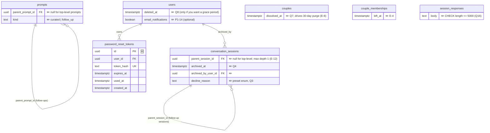

# ERD · MVP-1 additions

[← Plan index](../README.md) · Builds on: [current schema](current-schema.md) · Tasks: [Phase 1](../tasks/phase-1-mvp-1.md), [Housekeeping](../tasks/housekeeping.md)

Only new or changed parts are shown. 🆕 = new table, ✏️ = new column on an existing table.

## Why follow-ups are child sessions

A follow-up has the same core rule as the main prompt: each partner answers independently, and nothing is
visible until both have submitted. Making it a `conversation_sessions` row with `parent_session_id` means
`session_responses`, `sessionViewerPhase`, `canViewerSeeAnswerText`, the mapper and the answering/waiting
components are all reused.

The differences for children are small and explicit:

1. **No reveal step** ([Q22](../03-product-decisions.md#q22)). Answers auto-show once both have submitted, so
   children never get `session_reveals` rows. Visibility checks "both submitted" when `parent_session_id`
   is set, and the viewer phase goes from `waiting_for_partner` straight to `revealed`.
2. **Hidden from the hub list.** `GET /sessions` returns top-level sessions only.
3. **Only created after both partners revealed the parent.**
4. **One level deep** ([E-12](design-review.md#e-12)).

*Rejected alternative:* separate `follow_up_responses` / `follow_up_reveals` tables. They're more explicit,
but they duplicate every hidden-answer rule and test.

## Session completion needs no column

[Q1](../03-product-decisions.md#q1) completion is derived: both partners have a `session_reveals` row on the
main session, and every non-archived child session has both responses submitted. Add `completed_at` only
if completion later needs an explicit action or becomes slow to compute.
