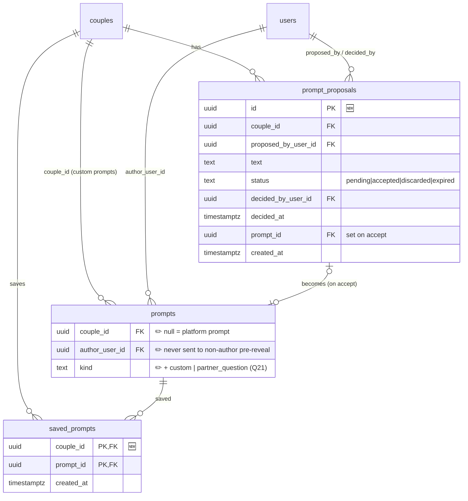

# ERD · MVP-2 additions

[← Plan index](../README.md) · Builds on: [MVP-1](mvp-1.md) · Tasks: [Phase 2](../tasks/phase-2-couple-created.md)

Only new or changed parts are shown. 🆕 = new table, ✏️ = new column on an existing table.

## Notes

- **Cap of 3 proposals:** `count(prompt_proposals WHERE proposed_by_user_id = me AND status = 'pending') < 3`.
  Enforce it in a domain function and check it inside the insert transaction.
- **Partner-added questions** ([Q21](../03-product-decisions.md#q21)) don't need a new table. They're
  `prompts` rows with `kind = 'partner_question'`, `couple_id` and `author_user_id` set, and `parent_prompt_id`
  pointing at the main prompt. They're answered in a child session that auto-shows answers
  ([Q22](../03-product-decisions.md#q22)). They skip `prompt_proposals`: the partner doesn't need to
  accept a follow-up question, only answer it, and skipping is allowed.
- **Attribution:** `author_user_id` is never sent to the non-author before both have revealed (P2-3). Partner-added
  questions are the exception: they're attributed from the start ([Q21](../03-product-decisions.md#q21)).
