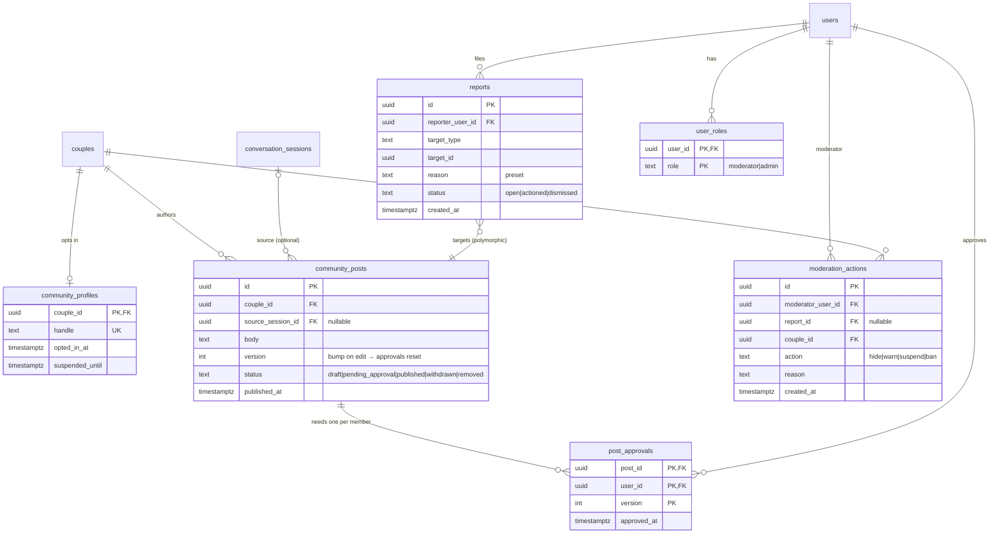

# ERD · MVP-3 sketch (community)

[← Plan index](../README.md) · Builds on: [MVP-2](mvp-2.md) · Tasks: [Phase 3](../tasks/phase-3-community.md)

This is shown only so the earlier phases don't block it. **Don't create these tables until
[P3-1](../tasks/phase-3-community.md) (the community spec) is written.**

## What the current schema already does right for this

- The couple is a first-class row, so the public actor can be the couple ([E-11](design-review.md#e-11)).
- Membership rows make "every member approved" a simple count.
- `audit_events` can record every moderation action.
