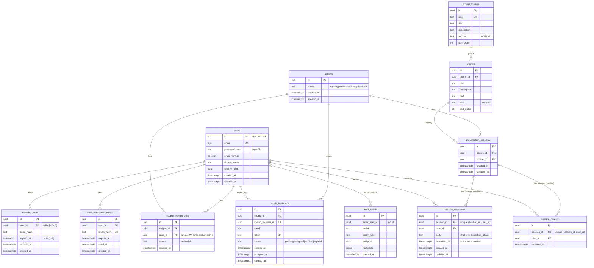
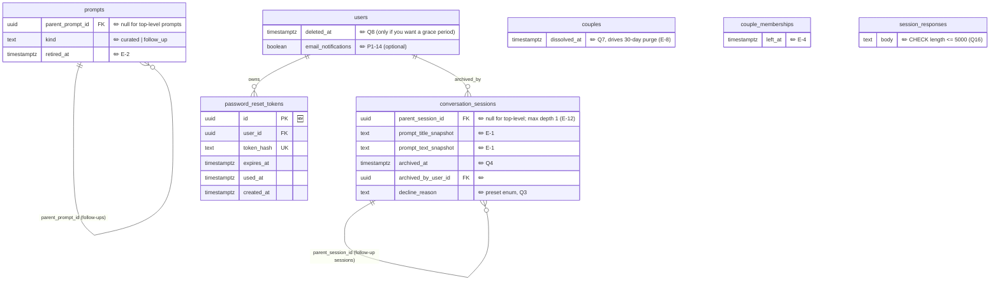
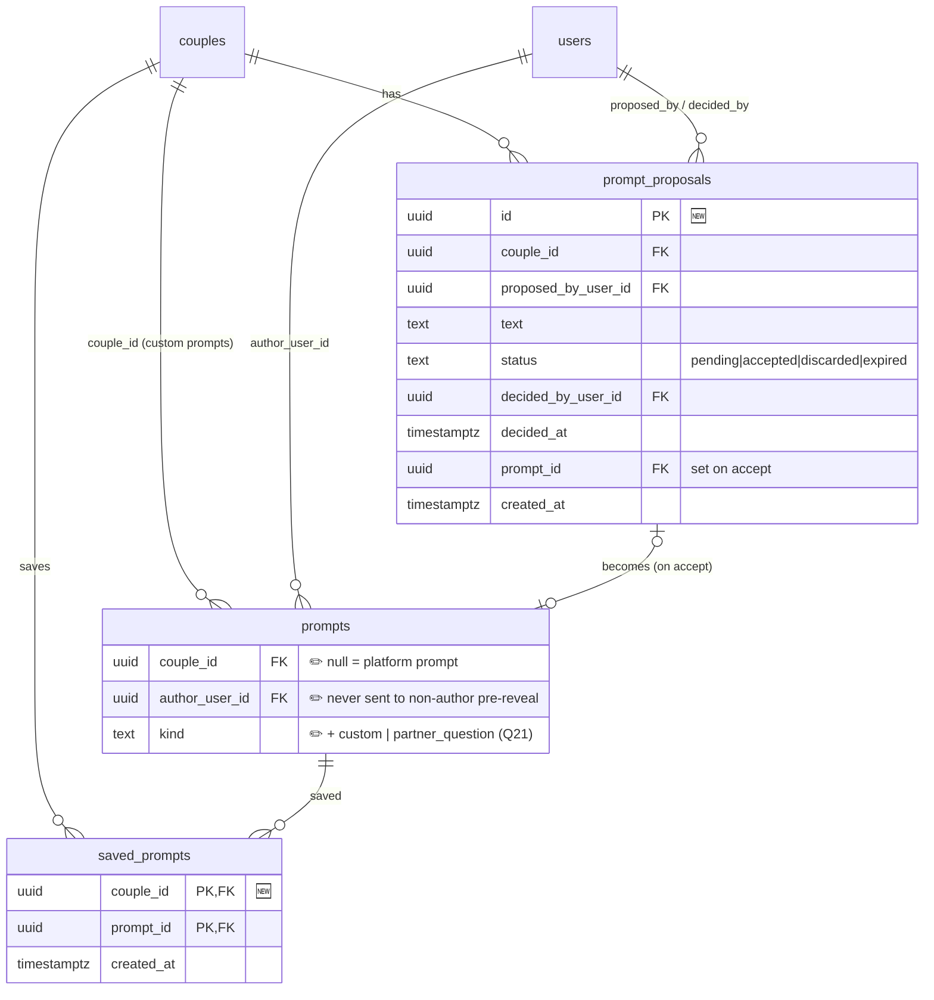
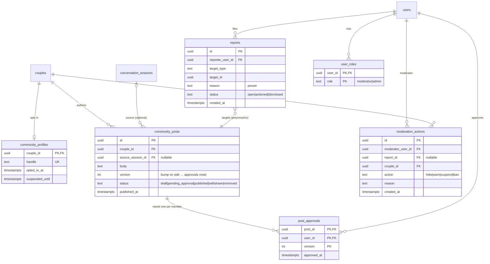

# Couple Space — remaining work (task list + ERD)

**Written:** 2026-10-14 · **Based on:** `main` @ `a4507ede` (auto-verify sandbox) · **Deployed:** Railway sandbox

> This is the working checklist. Behaviour authority is still [`scope.md`](scope.md).
> In this session Claude acted as **the client (product owner)**: the open questions have been
> answered as client decisions (marked **🟢 Client decision**). They're binding for the build unless
> you overrule them, and they should be copied into `scope.md` (task D-4) so there's one source of truth.
> The few questions only you can answer are in §3.2.

## How to use this file

1. Work top to bottom. Phases are ordered by dependency; inside a phase, tasks are ordered too.
2. Tick `- [ ]` boxes as you go. Each task has an ID (`P0-3`) so commits/branches can reference it.
3. Sizes: **S** ≈ an evening · **M** ≈ 2–3 sessions · **L** ≈ a week of evenings.
4. When you finish a session, add a line to the **Progress log** at the bottom.

---

## 1. Where the app actually is

### Works today (local + Railway)

| Area | Status | Where |
| --- | --- | --- |
| Register / login / refresh / logout (API) | ✅ | `apps/api/src/auth` |
| Email verification (bypassed on Railway by `SANDBOX_AUTO_VERIFY`) | ✅ | `auth.service.ts`, `config/env.ts` |
| Create couple, invite partner, accept/revoke invite | ✅ | `apps/api/src/couples`, `/couple`, `/invite/[token]` |
| `/couple` hub: members, welcome banner, Start CTA, sorted conversation list | ✅ | `app/(app)/couple/page.tsx` |
| Themes + curated prompts (6 × 3, seeded every deploy) | ✅ | `packages/database/seed` |
| `/start` → `/start/[slug]` → pick prompt → `POST /sessions` | ✅ | `app/(app)/start` |
| Session API: get (redacted), submit (immutable), per-user reveal | ✅ API only | `apps/api/src/conversations` |
| Domain rules: viewer phase, answer visibility (+ tests) | ✅ | `packages/domain` |

### Why you can't go further

Picking a prompt creates a session and calls `router.push('/conversation/{id}')` — **but there is no
`/conversation/[id]` route in `apps/web`**, so you land on a 404. The hub cards link there too.
Everything needed behind that page (hooks `useSessionQuery`, `useSubmitResponseMutation`,
`useRevealSessionMutation`, and the API) already exists. **The single most valuable next task is
that page (Phase 0).**

Side effects of the gap you'll see on Railway right now:

- Every prompt click creates a real session row — you probably have orphan sessions in the hub.
- The prompt card isn't disabled while the mutation is pending, so a double-click creates two sessions.

### Not built at all

Logout button / app header, follow-ups (guided discussion), custom prompts, session completion,
password reset, account/couple settings, leaving a couple, legal pages, CI, monitoring, community,
moderation.

---

## 2. 🟢 Client decision — redefine MVP

`scope.md` currently defines MVP as **five** slices: formation → conversation engine → community →
publishing → moderation. For a solo maintainer that is a very long road before a real couple can use
anything, and the scope's own principle says *"private couple experience must provide value even if
the community has zero contributions"*. Community without working moderation tooling is also the
riskiest thing you could ship.

**Client decision:** split into three releases, each shippable on its own.

| Release | Goal | Contains | Ships to |
| --- | --- | --- | --- |
| **MVP-1 · Private beta** | A real couple can complete the core loop and come back to it | Formation (done) · full conversation loop · curated follow-ups · account essentials · safety/legal · ops basics | Invited couples (friends, ~5–20) |
| **MVP-2 · Couple-created** | Couples can bring their own subjects | Custom prompt propose/accept (T3) · anonymous partner prompts on `/start` (T4) · session completion/archiving | Same beta, wider |
| **MVP-3 · Community** | Opt-in sharing between couples | Community profile opt-in · joint-approval publishing · reporting · moderation + enforcement | Public launch |

What this changes in `scope.md`:

- [ ] **D-1** Promote the three-release split into `scope.md` → "MVP foundation (implementation order)". Community stays MVP for *public launch*, just not for the *beta*.
- [ ] **D-2** Move "custom prompts" from MVP-1 to MVP-2 (the walking skeleton is curated-only anyway).
- [ ] **D-3** State that "guided discussion" in MVP-1 = **curated follow-ups only**; partner-added questions arrive with MVP-2 as *both-answer* child sessions (Q21), replacing the "directed" model.

---

## 3. 🟢 Client decisions

### 3.1 Answered by the client in this session

These are the `scope.md` open questions plus ones this review found. Each answer is the simplest
rule that keeps the product private-first without painting the schema into a corner. You can
overrule any of them, but do it **before** the task that depends on it.

| # | Question | Client decision | Blocks |
| --- | --- | --- | --- |
| Q1 | When is a session "completed"? | **Derived, no column:** completed when both partners have revealed the main prompt **and** no follow-up/discussion question is still in progress (every started child session has been **submitted** by both, or archived — follow-ups have no reveal step, see Q22). While a child is open, the session is **"In discussion"** and stays in the active list. Starting a new follow-up on a completed session moves it back to active. | P1-6 |
| Q2 | Concurrent sessions per couple? | Unlimited (already decided for T0) — revisit after beta feedback. | — |
| Q3 | Can a partner skip/decline a prompt? | Yes, either partner; optional **preset** reason, no free text (already suggested in walking-skeleton plan). | P1-7 |
| Q4 | Can a session be deleted/archived? | Archive only (hidden from hub, kept in history). No hard delete in MVP-1 except via account deletion. | P1-7 |
| Q5 | Draft autosave? | Yes — the row already exists with `submitted_at = null`; save `body` on blur/debounce. | P0-4 |
| Q6 | How does a partner learn something changed (no notifications yet)? | Refetch on window focus + light polling (every 15–30 s) on the session page only. Email notifications later (P1-14). | P0-6 |
| Q7 | Leaving / dissolving a couple — what happens to shared answers? | Either partner can leave; couple → `dissolved`, memberships → `left`; **all session content becomes inaccessible to both** (not handed to either). Confirmation step + audit event. | P1-11 |
| Q8 | Account deletion — what happens to my answers that my partner already revealed? | Delete them. Partner sees "This answer was removed". Couple is dissolved if one member deletes. | P1-12 |
| Q9 | Age gate | DOB is already collected — **18+ only**, enforced at register (server-side). | P1-9 |
| Q10 | Re-enable real email verification before beta? | Yes: `SANDBOX_AUTO_VERIFY=false` for any environment real couples use. | P1-10 |
| Q11 | Follow-ups for custom prompts | A small generic set (scope already says this). Only matters in MVP-2. | P2-* |
| Q12 | "Dual liability" (scope open question) | Park until MVP-3. | P3-* |
| Q13 | If we reword a curated prompt, should old sessions change? | **No.** A session keeps the exact wording both partners answered. Snapshot the prompt text onto the session (see ERD §5.0). | P0 / H-11 |
| Q14 | Can a curated prompt be removed? | Retire it, never delete it: `prompts.retired_at` hides it from `/start`, and existing sessions still work. | H-11 |
| Q15 | Can partners see *when* the other answered? | Yes, "answered" only, with no timestamp in the UI. The timestamp is stored but not shown, so nobody feels watched. | P0-2 |
| Q16 | Is answer length limited? | 1–5,000 characters, enforced in the domain schema and with a DB `CHECK`. | P0-2 |
| Q17 | Is the answer text encrypted beyond Railway's disk encryption? | Not for beta. Answers are never logged and are scrubbed from error reports (P1-18). Revisit app-level encryption before public launch. | P1-18 |
| Q18 | Data retention after dissolution or deletion | Dissolved couple's session content is hard-deleted after 30 days. Audit rows are kept, without content. | P1-11, P1-12 |
| Q19 | Can someone re-couple after leaving? | Yes, immediately, into a new couple. The old couple's history never carries over. | P1-11 |
| Q21 | Partner-added discussion questions: one-sided ("directed") or both answer? | **Both answer.** After both have revealed, either partner can write their own follow-up question. It becomes a child session exactly like a curated follow-up: both answer independently with soft-lock; answers auto-show once both have submitted (Q22). Attributed to its author (it's inside a session they're both already in, so anonymity is pointless). Max 3 open partner-added questions per session. This replaces the "one poses, the other answers" wording in `scope.md`, which is one-sided pressure and DM-shaped. **Ships in MVP-2** (P2-7). | P2-7 |
| Q22 | Do follow-ups (curated or partner-added) need their own Reveal tap? | **No.** Follow-ups keep blind answering (nothing visible until both have submitted), but answers **auto-show** to both as soon as the second partner submits. Only the main prompt keeps the per-user Reveal moment. Rejected alternative: instant visibility on submit — it lets the second answerer react instead of answer, exposes whoever goes first, and turns discussion into a two-person thread. Supersedes `scope.md` "answer visible to both on submit" for partner-added questions. | P1-8, P2-7 |
| Q20 | Display name: required, and unique? | Required, not unique, 1–40 characters, editable. It's only ever shown to your partner in MVP-1. | P1-4 |

- [ ] **D-4** Copy the answers to Q1–Q20 into `scope.md` and remove them from "Open product questions".

### 3.2 Questions only you can answer (as the real-world owner)

These depend on facts about you rather than product taste, so the client can't decide them:

- [ ] **O-1** Legal entity and jurisdiction. Are you operating as a sole trader in the UK? This affects the privacy policy wording, the ICO registration fee and the age gate wording.
- [ ] **O-2** Where real couples' data lives. Is the Railway region (EU or US) acceptable for UK users' intimate data? If not, pin the beta DB to an EU region.
- [ ] **O-3** Monetisation intent, even if it's years away. You don't need to build anything, but say so if "premium" will mean per-couple subscriptions. The billing owner would then be the couple, not a user, and the ERD in §5.4 should allow for that.

---

## 4. Task list

### Phase 0 — Unblock the core loop (do this first)

Goal: two people can go hub → start → answer → wait → reveal → see both answers, on Railway.
Reference: walking-skeleton plan step 5, [`2026-09-21-conversation-walking-skeleton.md`](../superpowers/plans/2026-09-21-conversation-walking-skeleton.md).

- [ ] **P0-1 · `/conversation/[id]` route shell** · S
  - Create `apps/web/app/(app)/conversation/[id]/page.tsx` (`"use client"`, read id with `useParams()` — Next 16 note in `apps/web/AGENTS.md`).
  - Use `useSessionQuery(id)`; loading → `PageLoading`; 404/403 → `RedirectTo` back to `/couple`.
  - Header: prompt title + text, "← Back to conversations" link.
  - Switch on `data.phase` to render one of four state components (P0-2…P0-5).
  - ✅ Done when: clicking a prompt lands on a real page showing the prompt.

- [ ] **P0-2 · Answering state** · M
  - Organism `answer-form`: textarea (`components/ui/textarea`), note "can't be changed after submitting", Submit → confirm `Dialog` → `useSubmitResponseMutation`.
  - Disable while pending; show mutation errors (`already_submitted` → refetch).
  - Partner status line: "{partner} has answered" if `partnerSubmitted` (allowed by FR-14).
  - ✅ Done when: submit works and the page flips to the waiting state without reload.

- [ ] **P0-3 · Waiting state** · S
  - Molecule `waiting-state` with the copy from the walking-skeleton plan; show your own submitted answer.
  - `aria-live="polite"` region (NFR-01).

- [ ] **P0-4 · Draft autosave** (Q5) · M — *optional for Phase 0, can slide to Phase 1*
  - API: `PUT /sessions/:id/responses/draft` (rejects if submitted; returns only the viewer's own draft).
  - Domain test: draft never visible to partner (it isn't today because `text` is redacted until reveal, but add an explicit test).
  - Web: debounced save + "Saved" hint; prefill textarea from the viewer's own `responses[].text`.
  - ⚠️ Check `canViewerSeeAnswerText` returns the viewer's **own** unsubmitted body, or the prefill will be empty.

- [ ] **P0-5 · Ready-to-reveal + revealed states** · M
  - `ready_to_reveal`: one **Reveal** button (not "reveal together"), no answer text → `useRevealSessionMutation`.
  - `revealed`: two `answer-card`s (yours first, then partner's) with display names.
  - Respect `prefers-reduced-motion` if you add a reveal animation.

- [ ] **P0-6 · Keep both screens fresh** (Q6) · S
  - `useSessionQuery`: `refetchOnWindowFocus: true` and `refetchInterval` (e.g. 20 s) **only while** phase is `waiting_for_partner`.
  - Hub list: refetch on focus.

- [ ] **P0-7 · Stop duplicate sessions from `/start/[slug]`** · S
  - Pass `disabled={createSession.isPending}` to every `PromptCard`; show error if create fails.
  - 🟢 Client decision: a couple can't have two *open* sessions on the same prompt. If one exists (not both revealed, not archived), `POST /sessions` returns it instead of creating a new one (200 with the existing `id`). Starting the same prompt again *after* completing it is allowed.

- [ ] **P0-8 · Clean the sandbox data** · S
  - Delete orphan sessions created while the page 404'd (SQL on Railway Postgres, or reset the DB — seed is idempotent).

- [ ] **P0-9 · Two-browser smoke, local then Railway** · S
  - Follow the reveal table in the walking-skeleton plan with a normal + private window.
  - Extend `docs/engineering/conversation-api-smoke.md` with a "web" section.
  - Tick walking-skeleton steps 5 and 6.

### Phase 1 — Private beta (MVP-1)

Goal: something you can hand to a real couple without hand-holding or embarrassment.

**Navigation & account**

- [ ] **P1-1 · App header + logout** · S — `(app)/layout.tsx`: brand, "Conversations", "Start", account menu with **Log out** (`POST /logout` exists; no web UI calls it today).
- [ ] **P1-2 · Hub invite-pending parity (T1)** · M — see [`04-tickets.md` T1](../extraction/04-tickets.md). Start disabled with reason; steps/education; resend/revoke invite.
- [ ] **P1-3 · Replace placeholder error/empty copy** · S — `/couple`, `/start`, `/start/[slug]` ("Error loading themes"), conversation page. Remove the `!` non-null assertion in `start/[slug]/page.tsx`.
- [ ] **P1-4 · Settings page `/settings`** · M — change display name (`PATCH /users/me`), change password (`POST /auth/change-password`, revoke other refresh tokens).
- [ ] **P1-5 · Password reset** · M — `password_reset_tokens` table (hash only, like `email_verification_tokens`), `POST /forgot-password`, `POST /reset-password`, web pages, revoke all refresh tokens on success. Always return 200 from forgot (no account enumeration).

**Conversation engine completion**

- [ ] **P1-6 · Session completion (Q1)** · M — couple-level session state, derived from the main session + its child sessions: `in_progress` → `in_discussion` (main revealed by both, a follow-up open) → `completed`. Domain function + tests in `packages/domain`. Hub: active (incl. "In discussion") first, completed in a "Past conversations" section below. **Depends on P1-8** (needs child sessions to exist).
- [ ] **P1-7 · Skip / archive (Q3, Q4)** · M — `conversation_sessions.archived_at`, `archived_by_user_id`, `decline_reason` (enum). Endpoint + hub filter + domain tests. Audit event.
- [ ] **P1-8 · Curated follow-ups (T5)** · L — see the ERD section for the recommended model (follow-ups are *child sessions*, so soft-lock is reused unchanged). Per Q22, child sessions **skip the reveal step**: `canViewerSeeAnswerText` treats "both submitted" as visible when `parent_session_id` is set, and `sessionViewerPhase` goes `waiting_for_partner` → `revealed` for children (no `ready_to_reveal`). No `session_reveals` rows for children.
  - Schema: `prompts.parent_prompt_id`, `kind = 'follow_up'`; `conversation_sessions.parent_session_id`.
  - Seed: 2–3 follow-ups per curated prompt in `catalogue.data.ts`.
  - API: `GET /sessions/:id` includes `followUps` only when **both** have revealed (FR-19); `POST /sessions/:id/follow-ups` `{ promptId }` creates the child session; `GET /sessions` excludes children.
  - Web: optional follow-up list + "take it offline" card under revealed answers (FR-20, FR-22). Same four-state component reused for the child.
  - Domain tests: follow-ups hidden until both revealed the main prompt; child answers hidden until both submitted; child answers visible to both immediately after the second submit with no reveal row.

**Safety, privacy, legal**

- [ ] **P1-9 · 18+ age gate (Q9)** · S — register schema in `packages/domain/src/auth-schemas.ts`; server-side check; clear copy.
- [ ] **P1-10 · Real email verification for beta (Q10)** · S — Brevo SMTP set on the beta environment; `SANDBOX_AUTO_VERIFY=false`. Consider a separate Railway environment (`sandbox` vs `beta`).
- [ ] **P1-11 · Leave couple / dissolution (Q7)** · L — `POST /couples/me/leave` with confirmation, statuses already exist in domain (`dissolving`/`dissolved`, `left`). Block all session endpoints for non-active couples. Audit events. `couples.dissolved_at`.
- [ ] **P1-12 · Account deletion (Q8)** · L — `DELETE /users/me` with password re-entry; dissolves couple; deletes responses/reveals; anonymises audit `actor_user_id` reference rather than deleting audit rows. `users.deleted_at` if you prefer a grace period.
- [ ] **P1-13 · Legal + trust pages** · M — Privacy policy, Terms, "How your answers stay private" explainer (great for trust, and it's literally your reveal table in plain English). UK GDPR basics: data export (`GET /users/me/export`, JSON) can be S if done after P1-12.
- [ ] **P1-14 · Email nudges (optional for beta)** · M — "Partner answered", "Ready to reveal". **No prompt or answer text in emails** (lock-screen privacy). Needs a `notification_preferences` table or a single `users.email_notifications` boolean.

**Security & ops**

- [ ] **P1-15 · Rate limiting** · S — `@nestjs/throttler` on login, register, forgot-password, resend-verification, invite accept.
- [ ] **P1-16 · Security headers** · S — `helmet` on Nest; `headers()` in `next.config.ts` (CSP can come later).
- [ ] **P1-17 · CI** · M — GitHub Actions: `pnpm install --frozen-lockfile`, `turbo run check-types lint test`, plus a Postgres service for API tests. Branch protection on `main`.
- [ ] **P1-18 · Error monitoring + logs** · S — Sentry (or similar) for web + api; make sure answer bodies are **scrubbed** from error payloads.
- [ ] **P1-19 · Backups** · S — confirm Railway Postgres backups are enabled; write the restore steps into `docs/deployment/railway.md`.
- [ ] **P1-20 · Hardening (T6)** · M — skeletons, keyboard paths (submit, reveal, dismiss welcome), focus rings, reduced motion, mobile widths, remove stray `console.log`s.

**Content**

- [ ] **P1-21 · Write more prompts** · M — 6 themes × 3 prompts is thin for repeat use. Aim for ~8–10 per theme + follow-ups. (Prompt *titles* are currently auto-generated as `Theme · 2` in the seed — give them real titles.)

**Beta launch checklist**

- [ ] **P1-22** Beta environment on Railway (separate DB from sandbox).
- [ ] **P1-23** Invite 3–5 couples; collect feedback with a simple form (outside the app — no in-app DM surface).
- [ ] **P1-24** Review feedback → revisit Q2, Q3, Q6 and the MVP-2 plan.

### Phase 2 — Couple-created prompts (MVP-2)

Promote the anonymous-pool model into `scope.md` first (open questions 1–4 in [`03-requirements.md`](../extraction/03-requirements.md)).

- [ ] **P2-1 · Scope promotion** · S — custom prompt lifecycle, attribution rule, expiry of never-used proposals, cap of 3.
- [ ] **P2-2 · Custom prompt propose / accept / discard (T3)** · L — `prompt_proposals` table (see ERD); cap 3 pending per proposer (domain fn + test); composer on `/start` "Your own" tab; partner inbox on hub.
- [ ] **P2-3 · Anonymous partner prompts on `/start` (T4)** · L — couple-scoped prompts mixed into the catalogue without authorship; attribution revealed only after both reveal. API test that `author_user_id` never leaks pre-reveal.
- [ ] **P2-4 · Generic follow-ups for custom prompts (Q11)** · S
- [ ] **P2-7 · Partner-added discussion questions (Q21)** · M — inside a session both have revealed, "Ask your own question" composer → creates a child session (`prompts.kind = 'partner_question'`, `couple_id` + `author_user_id` set, `parent_prompt_id` = the main prompt). Reuses the P1-8 child-session machinery and the four-state page. Cap 3 open per session (domain fn + test). Update `scope.md` Guided discussion wording (D-3) and retire FR-23's "directed" model.
- [ ] **P2-5 · Session history view** · M — "Past conversations" with search by theme. (Roadmap item — only once promoted.)
- [ ] **P2-6 · Save / favourite prompts** · S — `saved_prompts (couple_id, prompt_id)`. (Roadmap item — only once promoted.)

### Phase 3 — Community (MVP-3, required before public launch)

Scope slices 3–5. **Design doc first** — none of this has requirements yet.

- [ ] **P3-1 · Community spec** · M — what is shareable (a revealed answer pair? a written reflection?), what the couple's public identity is (handle, no names/photos), age/consent rules, dual liability (Q12).
- [ ] **P3-2 · Opt-in community profile** · M — both partners must opt in.
- [ ] **P3-3 · Joint-approval publishing** · L — draft → both approve → published; any edit resets approvals; either partner can withdraw at any time.
- [ ] **P3-4 · Reporting** · M — report a post/couple with preset reasons.
- [ ] **P3-5 · Moderation console + enforcement** · L — roles, queue, actions (hide, warn, suspend couple), audit trail, appeals copy. Suspension blocks publishing.
- [ ] **P3-6 · Stronger identity checks before public launch** · ? — scope says design later.

### Housekeeping / tech debt (slot in anywhere)

- [ ] **H-1** Move `SessionDetailDto` / `SessionListItem` into `packages/domain` (currently duplicated in `apps/api/.../session-detail.mapper.ts` and `apps/web/hooks/use-sessions.ts`). Also `prompt.kind` is hard-coded to `"curated"` in the DTO — widen when P1-8/P2-2 land.
- [ ] **H-2** `refresh_tokens.expires_at` is `timestamp` **without** time zone and `user_id` is nullable — make it `timestamptz` + `notNull`.
- [ ] **H-3** Add indexes on foreign keys Postgres doesn't index for you: `conversation_sessions(couple_id)`, `couple_memberships(couple_id)`, `couple_invitations(couple_id)`, `prompts(theme_id)`, `refresh_tokens(user_id)`.
- [ ] **H-4** Convert `text` status columns to Postgres enums or `CHECK` constraints, so the DB enforces the domain status lists.
- [ ] **H-5** `listSessions` orders `updatedAt ASC`; the web re-sorts anyway — pick one place.
- [ ] **H-6** Docs still describing Supabase (build brief, setup runbook, platform spec) → local Postgres + Railway.
- [ ] **H-7** `app/api/relationship-quote` is a Next API route; the walking-skeleton constraints say "no Next BFF". Either document it as the one exception or move it to Nest.
- [ ] **H-8** Decide what to do with `between-us-source/` (Lovable prototype) — archive to its own branch once the conversation page is built, to keep the repo lean.
- [ ] **H-9** Couple hub has `Loading couple…` raw text vs `PageLoading` elsewhere — unify.
- [ ] **H-10** Add web tests once flows stabilise (Playwright for the two-browser reveal flow is the one test worth having).
- [ ] **H-11** Prompt snapshot + retirement (Q13, Q14). Add `conversation_sessions.prompt_text_snapshot` (backfill from `prompts.text`) and `prompts.retired_at`. Read the snapshot in `loadDetail` and `listSessions`, and filter retired prompts out of `listThemes`. **Do this before the beta, while there is no real data to backfill.**
- [ ] **H-12** DB `CHECK` constraints: `session_responses.body` ≤ 5000 chars (Q16), `submitted_at IS NULL OR length(body) > 0`, and `users.display_name` 1–40 chars (Q20).
- [ ] **H-13** Add `couple_memberships.left_at` so membership history has an end date (Q19).

---

## 5. ERD

### 5.0 Design review: issues you may not have considered yet

Each point is a modelling issue the current schema doesn't handle yet, with the client's decision on it.
The diagrams in §5.2 to §5.4 already include these decisions.

| # | Issue | Why it matters | Decision |
| --- | --- | --- | --- |
| E-1 | **Prompt wording can drift.** Sessions reference `prompts.id`, and the seed upserts on every deploy. | If you fix a typo or reword a prompt, every past conversation silently changes the question both partners answered. | Snapshot `prompt_text_snapshot` (and title) onto `conversation_sessions` at create time (Q13, H-11). |
| E-2 | **Prompts can't be removed safely.** Deleting a prompt breaks the FK, and leaving it in shows it on `/start`. | You will prune weak prompts after beta feedback. | `prompts.retired_at` (Q14). The seed should retire prompts rather than delete them. |
| E-3 | **"Is this user in this couple?" is only enforced in code.** Nothing in the DB stops a `session_responses` row for a non-member. | The rule is correct today in `requireSessionMember`, but a future endpoint could forget it. | Keep it in app code (a composite FK would be clumsy), and add a domain-level test helper used by every new session endpoint. |
| E-4 | **Membership history.** `couple_memberships` has `status` but no `left_at`. | Dissolution and re-coupling (Q19) need to know when someone left, for audit and the 30-day purge (Q18). | Add `left_at` (H-13). Re-coupling creates a new membership row in a new couple. |
| E-5 | **Response rows exist before anyone answers.** One row per member is inserted at session create. | Good for drafts, but it bakes in "members at creation time". If someone leaves mid-session, their empty row stays. | Fine for MVP. On dissolution, all sessions become inaccessible anyway (Q7). |
| E-6 | **Status columns are free `text`.** | A typo like `'actve'` would be accepted by the DB. | Postgres enums or `CHECK` constraints that mirror `packages/domain` status lists (H-4). |
| E-7 | **Deletion vs audit.** `audit_events.actor_user_id` has no FK, which is good. But `metadata` could contain content. | Account deletion (Q8) must not leave intimate text behind in audit metadata. | Rule: audit metadata holds **ids and enums only, never answer or prompt text**. Add a code-review checklist line for it. |
| E-8 | **Purge job.** Q18 needs something to hard-delete dissolved-couple content after 30 days. | No scheduler exists yet. | A Railway cron service running a script in `packages/database`, scheduled daily. Purge sessions where `couples.dissolved_at < now() - 30 days`. |
| E-9 | **Timezones.** All timestamps except `refresh_tokens.expires_at` are `timestamptz`. | That's correct. Mixed types cause off-by-an-hour bugs around BST. | Fix the one outlier (H-2). Keep storing UTC and format in the browser. |
| E-10 | **Billing owner (future).** | If premium ever happens, the payer is likely the couple, but couples dissolve. | Nothing to build now. Don't put user-level plan columns on `users`. If needed later, `subscriptions` hangs off `couples` (pending O-3). |
| E-11 | **Couple-level identity for community.** | The community's public actor is the couple, so a handle has to outlive name changes but not dissolution. | `community_profiles` keyed by `couple_id` (§5.4). Dissolution withdraws the profile and its posts. |
| E-12 | **Follow-up depth.** Child sessions could nest forever. | UI and queries get messy. | One level only. A follow-up session can't have its own follow-ups. Enforce with a domain check on create. |

### 5.1 Current schema (as of migration `0005`)



**What's good about it already:** membership rows instead of `partner_a/partner_b` (multi-partner stays
possible), per-user reveal rows (exactly the product rule), one response row per member created
up-front, tokens stored as hashes, an audit table from day one.

### 5.2 Proposed additions for MVP-1 (Phase 1)

Only the new/changed bits are shown. 🆕 = new table, ✏️ = new columns on an existing table.



**Why follow-ups are child sessions (recommended):** a follow-up has exactly the same rules as the
main prompt — independent answer, soft-lock, per-user reveal. Modelling it as a
`conversation_sessions` row with `parent_session_id` means `session_responses`, `session_reveals`,
`sessionViewerPhase`, `canViewerSeeAnswerText`, the mapper and the four-state web page all work
unchanged. The only new rules are "children are hidden from the hub list" and "children can only be
created once both members revealed the parent".

*Alternative:* separate `follow_up_responses` / `follow_up_reveals` tables. More explicit, but
duplicates every soft-lock rule and test. Not recommended.

**Session completion (Q1)** needs no column if "completed = both revealed" — it's derivable from
`session_reveals`. Add `completed_at` only if completion later needs an explicit action.

### 5.3 Proposed additions for MVP-2 (Phase 2)



Cap of 3: `count(prompt_proposals WHERE proposed_by = me AND status = 'pending') < 3` — enforce in a
domain function, checked inside the insert transaction.

### 5.4 Sketch for MVP-3 (Phase 3) — design before building

Shown only so the earlier phases don't block it. **Do not create these tables until P3-1 is written.**



Things the current schema already does right for this: the couple is a first-class row (public actor
= couple), membership rows make "every member approved" a simple count, and `audit_events` can
record every moderation action.

---

## 6. Suggested order at a glance

```
P0-1 → P0-2 → P0-3 → P0-5 → P0-6 → P0-7 → P0-9        ← you can demo the full loop here
H-11 → H-12 → H-2                                     ← schema fixes while the DB has no real data
   D-1…D-4 (scope decisions, an evening of writing)
P1-1 → P1-3 → P1-8 (follow-ups) → P1-6 → P1-7
P1-15 → P1-16 → P1-17 → P1-18 → P1-19                 ← ops, before strangers touch it
P1-5 → P1-9 → P1-10 → P1-11 → P1-12 → P1-13
P1-2 → P1-20 → P1-21 → P1-22…24                       ← private beta
Phase 2 → Phase 3
```

---

## Progress log

| Date | Task reached | Notes |
| --- | --- | --- |
| 2026-10-14 | Task list + ERD written | App stops at `/conversation/[id]` (route missing) |
| 2026-10-15 | Client decisions Q1–Q20 + ERD review E-1…E-12 added | Owner-only questions O-1…O-3 still open |
| 2026-10-15 | Q1 revised (completion waits for open follow-ups, new "In discussion" state); Q21 + P2-7 partner-added questions added | Gap found by owner |
| 2026-10-15 | Q22: follow-ups keep blind answering but auto-show (no Reveal tap) | Instant visibility on submit considered and rejected |
